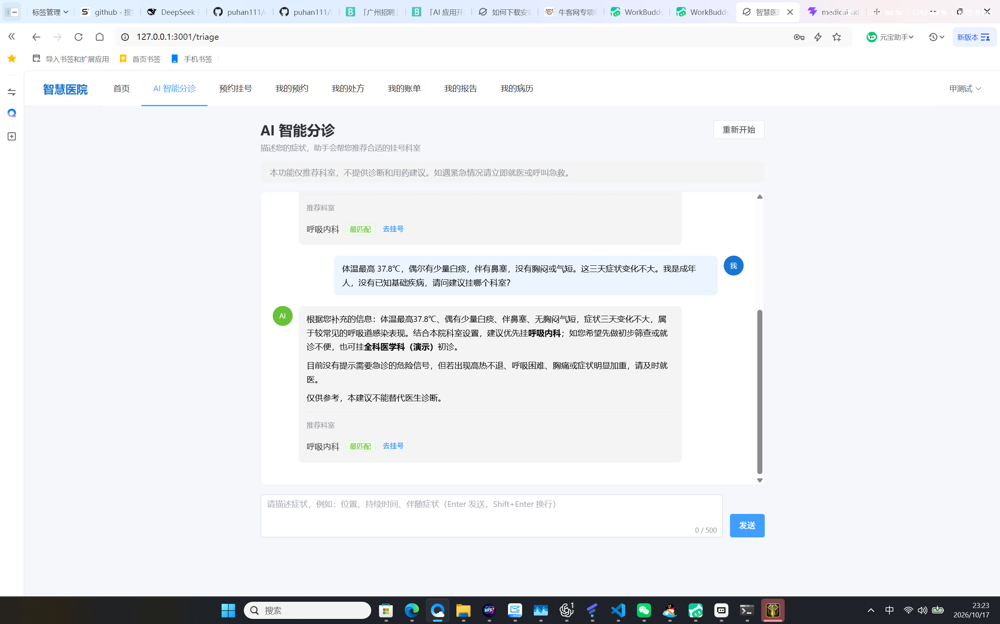
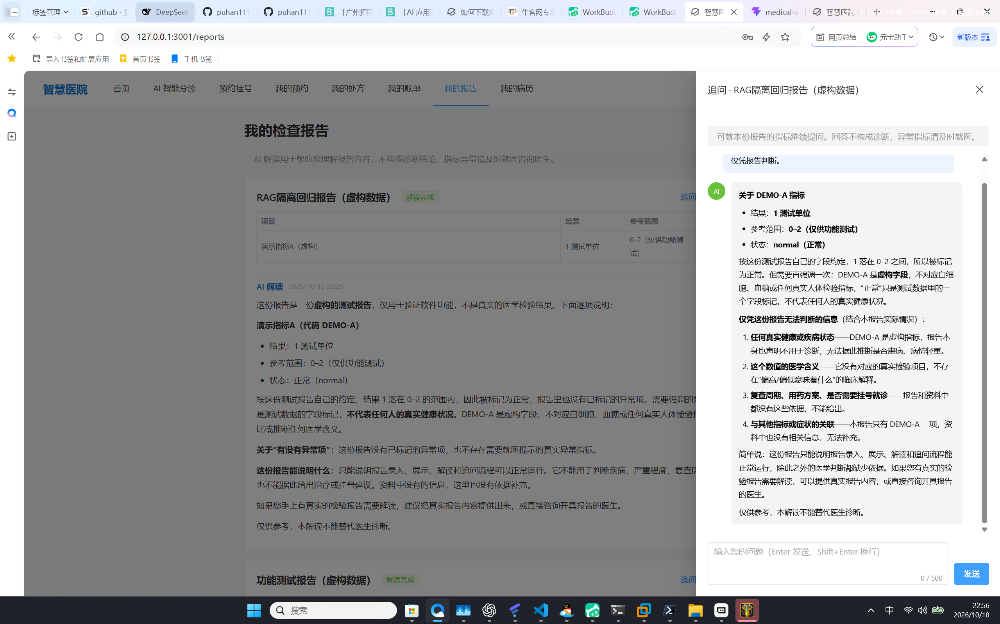
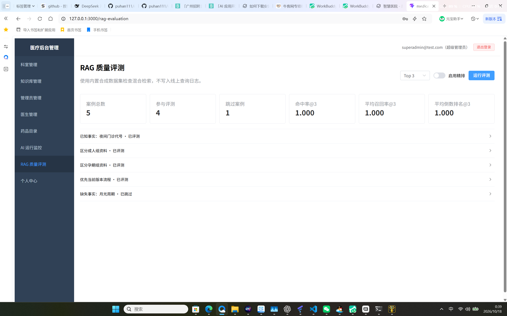
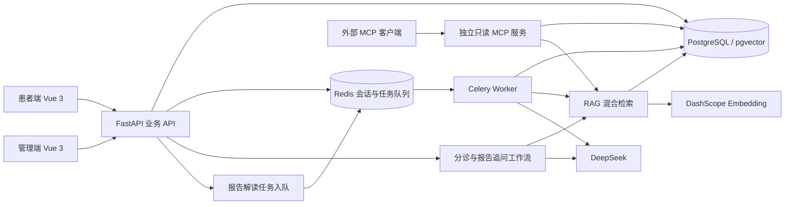

# 智能医疗预约诊疗系统

[](https://github.com/puhan111/intelligent-medical-consultation-system/actions/workflows/ci.yml)

基于 **FastAPI、Vue 3 和 DeepSeek** 的全栈医疗 AI 演示系统，实现多轮分诊、检查报告异步解读及流式追问，并串联预约、接诊、处方、收费和发药流程。

工程实践包括 **RAG 混合检索与评测、受限只读 MCP 工具服务、流式异常处理、异步任务幂等与 CI 自动检查**。

> 本项目使用虚构测试数据，用于学习、演示和求职展示。支付回调为模拟流程，未对接真实医保或支付网关；AI 输出用于解释与参考，不替代医生诊断。

## 运行演示

### 多轮分诊与科室推荐



2026-10-17 本地演示：导入六个科室后，使用虚构病例完成两轮对话，页面显示呼吸内科推荐和“去挂号”入口。截图展示本次交互结果，不代表医学准确率或所有病例均已验证；挂号入口的后续流程尚未在本次演示中验收。

### 报告解读与流式追问



2026-10-18 患者端实际操作截图：新的“RAG隔离回归报告（虚构数据）”显示解读完成，追问回答解释 DEMO-A 的测试字段含义和限制，图中未出现此前的评测标记。配合引用来源与流式事件记录，验证本次虚构报告的解读和追问；不据此宣称真实医疗效果或完整业务录入流程通过。

### 固定合成集检索评测



2026-10-18 页面记录（业务/评测隔离修复前的运行副本）：Top K=3，精排关闭，5 个案例中 4 个计分、1 个跳过；Hit@3、平均 Recall@3、MRR@3 均显示 1.000。它只反映该固定合成集的检索回归，不代表真实问答准确率，也不能作为隔离修复部署成功的证据。该截图只作为页面展示；修复后运行结果及版本指纹见下方链接。

隔离修复后的独立 VM 已重新运行相同配置，三项 @3 指标仍为 1.000；[原始评测结果](docs/evidence/rag-evaluation-result.json)与[运行镜像及文件指纹](docs/evidence/deployment-manifest.json)已归档。上方图片保留为旧副本的页面记录，新的运行结果以 JSON 为准。

## 核心功能

### 业务检索与历史结果对照

在原 WSL 数据恢复到 VM 后，业务检索与评测检索的隔离仍有效。原报告的旧解读包含评测资料，按原样保留；为同一演示患者追加一份新的虚构回归报告，并补充 DEMO-A 软件字段说明。

新报告解读引用只来自业务资料，经前端代理的流式追问收到 done；本次新输出未出现评测标记。真实数据库验证业务/评测向量候选分别为 3/5，评测专属词的全文查询在业务范围返回 0、评测范围返回 2。固定集三项 @3 指标仍为 1.000。[虚构回归原始结果](docs/evidence/rag-business-regression-result.json)

原报告相关内容指纹未变，账号和科室未改动。此例说明检索修复、业务资料补充与历史回答处理是不同环节，不代表真实医疗效果或完整录入流程验收。

| 场景 | 实现 |
| --- | --- |
| 不确定挂哪个科室 | 根据症状和多轮上下文检索分诊指引，结合数据库中的院内科室生成推荐 |
| 查看检查报告 | 后台录入结构化报告或 CSV，Celery 异步执行资料检索、模型解读、内容审核与结果保存 |
| 继续询问报告内容 | 将报告指标、已有解读、历史对话与检索片段注入 Prompt，流式返回回答 |
| 检查检索表现 | 固定合成案例计算 Hit@K、Recall@K、MRR@K，支持管理页面与脚本查看诊断信息 |
| 向外部客户端提供工具 | 独立 MCP 服务提供本人报告状态查询和医学参考片段检索，限制身份、参数、频率与数据库写入 |
| 管理就诊流程 | 患者端和管理后台覆盖预约、接诊、报告、处方、账单和发药相关操作 |

## 架构与数据流



分诊与报告追问采用代码驱动的自定义工作流，医疗项目未使用 LangGraph 或 LangChain AgentExecutor。MCP 是独立工具入口，不能将其等同于分诊 Agent 已自主调用工具。

## 工程实现

### RAG 混合检索

- 使用 DashScope Embedding 将文本向量化，以 pgvector 余弦距离召回候选。
- PostgreSQL 全文检索补充词项召回，通过 RRF 融合两个候选排序。
- Rerank 为可选增强，默认关闭；调用失败时回退 RRF 结果，并记录诊断状态。
- 分诊指引和医学参考资料按来源类型过滤，记录检索耗时与命中片段。

实现入口：[rag_service.py](backend/app/services/common/rag_service.py)、[ranking.py](backend/app/services/common/ranking.py)。

业务与固定评测显式隔离：业务检索默认排除 `rag-eval://`，评测入口仅选择该范围；向量召回与全文召回都在排序截断前过滤，诊断和评测配置记录 `corpus`。

### 异步任务与流式交互

- 报告解读由 Celery 执行，使用 PostgreSQL 事务级咨询锁限制同一报告并发处理，已完成任务直接跳过。
- 报告追问校验患者、报告和会话的对应关系，并传入报告原始内容与已有解读。
- 前端按 NDJSON 事件接收增量回答；缺少 `done` 事件时按中断处理，移除未完成回答并恢复问题草稿。
- 统一 LLM 服务集中处理超时、部分错误重试、调用日志与每日 Token 预算。

实现入口：[报告解读任务](backend/app/schedule/jobs/report_interpret.py)、[报告追问](backend/app/services/client/report_chat.py)、[流式解析](medical-client/src/utils/ndjsonStream.ts)。

### 只读 MCP 服务

| 工具 | 范围 |
| --- | --- |
| `get_my_report_status` | 查询当前患者本人指定报告的解读状态 |
| `search_medical_references` | 检索医学参考资料，返回受长度和数量约束的来源与片段 |

通过患者 JWT、报告归属过滤、严格参数校验、限流和默认只读数据库事务约束调用。服务不提供任意 SQL、数据修改或自动诊断工具。

实现入口：[MCP 协议服务](backend/app/mcp_server.py)、[只读业务服务](backend/app/services/common/mcp_readonly.py)。

## 验证记录与边界

截至 2026-10-17 核验，提交 `4056aab` 对应的 [2026-10-06 CI 运行](https://github.com/puhan111/intelligent-medical-consultation-system/actions/runs/37467982746) 成功。四类检查产生五个任务实例，前端矩阵分别检查两个应用。

| 检查 | 已核验结果 |
| --- | --- |
| 后端 | 依赖检查、关键 lint 和 pytest 步骤通过 |
| 患者端与管理端 | 两个应用的 TypeScript 检查与构建通过；患者端流式解析测试通过 |
| Compose 与镜像 | 生产/开发配置校验、后端镜像构建通过 |
| 数据库迁移 | 空库升级至 head、迁移后模型一致性检查通过 |

测试与构建通过不等同于完整业务端到端验收或真实医疗上线验证。测试范围可查看 [后端测试目录](backend/tests) 和 [患者端流式测试](medical-client/tests/ndjsonStream.test.mjs)。

### 独立 VM 验收（2026-10-18）

此次更新在 Windows Python 3.12 发布副本中完成 153 项后端回归及关键 lint，双前端类型检查与构建通过。已通过 SSH 在普通 Ubuntu VM 的独立 Compose 项目中部署，旧服务保留；最新提交的 CI 状态见页首徽章及 Actions 运行记录。

| 验收项目 | 实际结果 |
| --- | --- |
| 数据库与账号 | 新库 Alembic 迁移、演示账号初始化、管理员与患者真实登录通过 |
| 前端与 API | 两个前端入口及其 API 代理返回 HTTP 200 |
| 异步报告解读 | Celery Worker 响应 pong，虚构报告任务完成并保存解读 |
| 流式追问 | 经患者端代理收到 NDJSON 增量与 done，本次回答未出现评测标记 |
| 检索范围 | 真实数据库验证两条召回路径的业务/评测来源隔离；本次报告引用仅来自业务资料 |
| 固定评测 | 4 个计分、1 个跳过；Top 3、精排关闭，三项指标均为 1.000 |

证据：[业务验收摘要](docs/evidence/verification-summary.json)、[检索隔离记录](docs/evidence/corpus-isolation-result.json)。

演示报告由初始化脚本创建，仅验证异步解读、保存及追问链路；本次没有验收从预约到医生接诊、检验科录入、收费发药的完整操作流程。小样本指标和一次成功回答不代表真实医疗效果或普遍正确性。

当前 VM 使用原 WSL 数据库的恢复副本。切换前备份源库与目标库，恢复后核对 20 张表的数量及数据指纹，保留账号密码哈希、业务 ID 与关联关系，并通过 Alembic 结构一致性检查。源库与原有 VM 数据库保留用于回退；切换后补充的业务资料和虚构回归报告见上方业务检索验证。

RAG 内置合成回归集共 5 个案例：4 个检索案例计分，1 个拒答案例跳过，因为检索排序指标无法证明最终回答是否正确拒答。相关指标衡量该数据集的检索排序表现，不代表真实医疗问答准确率。上方截图记录旧运行副本的页面结果；测试数量应以对应代码版本的测试报告为准。

## 本地启动

需要 Git、Docker Compose、Node.js/npm，以及本地配置的模型服务凭证。前端 CI 使用 Node.js 24，后端镜像使用 Python 3.12。

### 1. 准备配置

克隆仓库后进入 `backend`。首次创建环境文件时执行：

```bash
cp .env.example .env
```

已有 `.env` 时保留原文件。依据 [.env.example](backend/.env.example) 在本地填写配置，凭证仅保存在本地。使用开发 Compose 自带数据库时，数据库地址为容器服务名 `postgres`、端口 `5432`，用户名、密码和库名需与该 Compose 服务一致；Redis 地址、密码也需对应其服务配置。模型相关配置和演示账号初始化见 [部署文档](部署文档.md)。

### 2. 启动后端及数据库

以下命令在 `backend` 目录执行，使用开发覆盖配置启动 PostgreSQL、Redis、FastAPI 和 Celery：

```bash
docker compose -f docker-compose.yml -f docker-compose.dev.yml up -d --build
docker compose -f docker-compose.yml -f docker-compose.dev.yml exec app alembic upgrade head
docker compose -f docker-compose.yml -f docker-compose.dev.yml exec app python scripts/init_data.py
```

数据库迁移负责建表，账号脚本负责初始化最小后台账号；医生、科室、药品和业务知识库需按 [部署文档](部署文档.md) 的数据准备步骤补齐。

默认后端端口由 `API_PORT` 决定，示例为 `8001`。默认生产 Compose 使用外部数据库；它不会自动构建或托管两个前端。

### 3. 启动两个前端

在 Windows PowerShell 中分别打开两个终端。以下环境变量仅对当前终端生效；若后端运行在虚拟机，将地址改为虚拟机的实际 IP 和 `API_PORT`。

患者端，在 `medical-client` 目录执行：

```powershell
$env:VITE_API_PROXY_TARGET = 'http://127.0.0.1:8001'
npm ci
npm run dev
```

管理端，在 `medical-admin` 目录执行同样的三条命令。

默认访问地址为患者端 `http://localhost:3001`、管理端 `http://localhost:3000`；实际端口以启动输出为准。上述方式为开发服务器，生产部署需另外构建前端并配置静态托管与 API 代理。

### 4. 可选服务

以下命令在 `backend` 目录执行：

```bash
# 显式启动只读 MCP 服务；需后端开发镜像已构建
docker compose -f docker-compose.yml -f docker-compose.dev.yml --profile mcp up -d mcp

# 显式启动 Flower 监控
docker compose -f docker-compose.yml -f docker-compose.dev.yml --profile monitoring up -d flower
```

MCP 仅映射到本机 `127.0.0.1:8765`，调用需患者身份凭证。客户端示例见 [mcp_client_demo.py](backend/scripts/mcp_client_demo.py)。

## 检索评测

在独立演示/评测数据库中使用合成资料。准备脚本会替换固定 `rag-eval://` 来源的数据，并调用配置的 Embedding 服务；资料准备与检索会消耗外部服务额度。

在 `backend` 目录执行：

```bash
docker compose -f docker-compose.yml -f docker-compose.dev.yml exec app python scripts/prepare_rag_eval_fixtures.py
docker compose -f docker-compose.yml -f docker-compose.dev.yml exec app python scripts/eval_rag_retrieval.py --top-k 3
```

脚本输出实际指标与 JSON 路径。开发 Compose 挂载 `scripts` 目录，默认结果保存在宿主机 `backend/scripts/eval_results/`。对外展示结果时附运行时间、代码版本、数据集、K 值、是否启用 Rerank、计分与跳过数量。

## 目录

```text
backend/
  app/api/                 患者端与管理端 API
  app/services/client/     分诊、报告追问等患者业务
  app/services/common/     RAG、LLM、评测与只读工具服务
  app/mcp_server.py        独立 MCP 协议入口
  app/schedule/jobs/       Celery 任务
  migrations/              Alembic 数据库迁移
  scripts/                 数据准备、评测和验证脚本
  tests/                   单元与 API 测试
medical-client/            患者端 Vue 3 / TypeScript
medical-admin/             管理端 Vue 3 / TypeScript
.github/workflows/ci.yml   自动检查流水线
部署文档.md                环境配置与业务演示步骤
```
